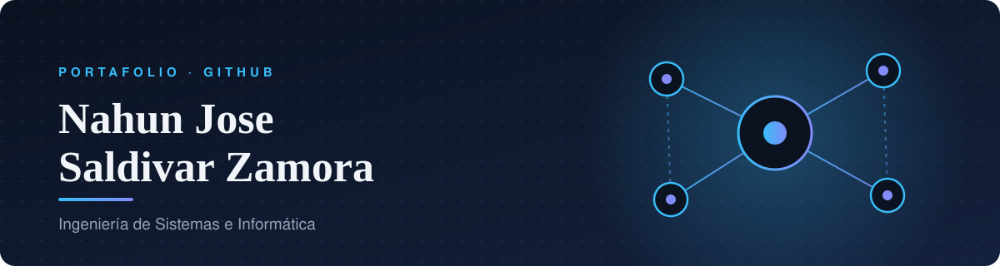

  

  
  
  

 

## ✦ Sobre mí

> Estudiante de décimo ciclo de **Ingeniería de Sistemas e Informática** (Universidad Continental).
> Apoye en el área de **Registros Académicos** y me interesan el desarrollo de software, las bases de datos y la innovación tecnológica.
> Me adapto con rapidez a nuevas tecnologías, procesos y tareas.

 

## ✦ Stack tecnológico

<table>
  <tr>
    <td><b>Lenguajes</b></td>
    <td>
      
      
      
      
    </td>
  </tr>
  <tr>
    <td><b>Backend</b></td>
    <td>
      
      
    </td>
  </tr>
  <tr>
    <td><b>Bases de datos</b></td>
    <td>
      
      
      
    </td>
  </tr>
  <tr>
    <td><b>DevOps y datos</b></td>
    <td>
      
      
      
      
      
      
    </td>
  </tr>
  <tr>
    <td><b>Metodologías</b></td>
    <td>Scrum · BPMN · UML · ITIL 4</td>
  </tr>
</table>

 

## ✦ Proyectos destacados

<table>
  <tr>
    <td width="33%" valign="top">
      <h3><a href="https://github.com/nsaldivar/proyecto-monolito-microservicios">Monolito vs. Microservicios</a></h3>
      Misma funcionalidad (usuarios, productos y pedidos) implementada en dos arquitecturas, con pruebas automatizadas, integración continua y monitoreo.
        
      <code>Node.js</code> · <code>PostgreSQL</code> · <code>Docker</code> · <code>Kubernetes</code> · <code>GitHub Actions</code> · <code>Grafana</code>
    </td>
    <td width="33%" valign="top">
      <h3><a href="https://github.com/nsaldivar/PA3_Service-desk_TI">Service Desk · ITIL 4</a></h3>
      Sitio web sobre el Service Desk y las prácticas de gestión de servicios según ITIL 4.
        
      <code>HTML</code> · <code>CSS</code> · <code>JavaScript</code>
    </td>
    <td width="33%" valign="top">
      <h3><a href="https://github.com/nsaldivar/PA1_GESTION_TI">Gestión de Servicios de TI</a></h3>
      Sitio web sobre conceptos clave y enfoques metodológicos de la gestión de servicios de TI.
        
      <code>HTML</code> · <code>CSS</code>
    </td>
  </tr>
</table>

 

## ✦ Formación y certificaciones

- **Ingeniería de Sistemas e Informática** · Universidad Continental · 2022 – 2026
- Introducción a Power BI y Taller de Preparación para Certificación en Power BI
- Gestión de Proyectos con Metodologías Ágiles y Enfoques Lean
- Diseño de Experiencia de Usuario (UX) para Negocios
- Taller de Prompt Engineering · IV Congreso Internacional de Ingeniería: Industria 4.0

 

## ✦ Contacto

¿Prácticas, proyectos o colaboración? Escríbeme a **nahun987654321@gmail.com** o por [LinkedIn](https://www.linkedin.com/in/nahun-jose-saldivar-zamora-0b8509346/).

 

  

